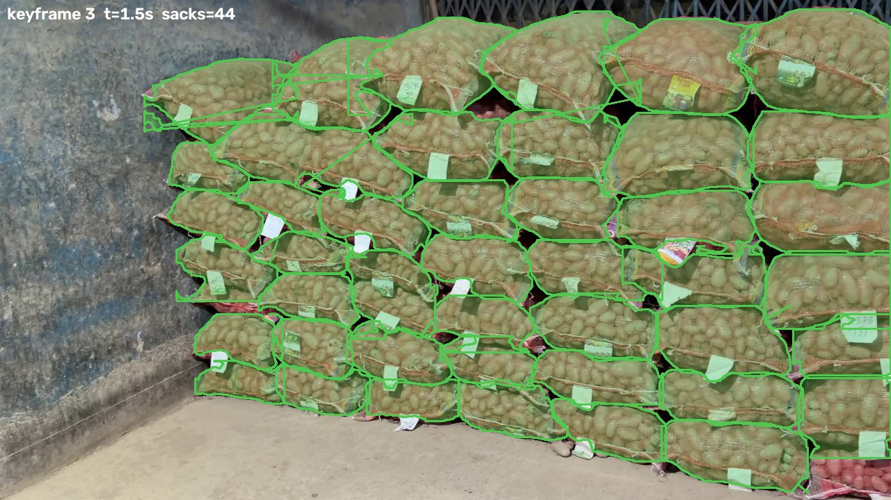

# ColdStore-Vision

Automated cold-storage sack inspection from video. Give it two phone walkthroughs of the same stack, recorded on different days, and it gives every sack a status with a written reason: NORMAL, WARNING, CRITICAL, MISSING, NEW or UNVERIFIED. No markers or rack configuration are needed.



**How it works:** sharp keyframes → cross-day alignment (CLIP + LoFTR) → sack outlines (trained YOLO11s-seg) → lighting compensation → sack matching (Hungarian algorithm) → colour, texture and motion checks → reports.

## Results

| Measure | Result |
|---|---|
| Detector mask mAP@50 / precision (test set) | 0.797 / 0.798 (targets 0.85 / 0.80, not yet met) |
| Automated tests | 16 of 16 pass |
| Real godown run, onion stack | 22 sacks: 4 NORMAL, 4 WARNING, 1 MISSING, 13 UNVERIFIED, in 791 s on a laptop CPU |

The run flagged a sack swapped between days and did not call sacks behind a pillar missing. The 13 unverified sacks come from filming each day from a different viewpoint. No ground truth was recorded for that pair, so no field accuracy figure is claimed. The sample output is in [outputs/onion_day1_vs_day2](outputs/onion_day1_vs_day2).

## Documentation

- **[GUIDE.md](GUIDE.md):** full walkthrough of each pipeline stage and why it was chosen, a map of every file, troubleshooting and a tester checklist.
- **[docs/](docs):** Software Requirements Specification and project report (PDF and Word).

## What is not in this repository

The raw footage, scraped images, packaged datasets, downloaded helper models and video renders are left out because of their size. The trained detector (`models/weights/best.pt`) is included, and helper models download on first run. Commands that use `footage\` need your own recordings; the synthetic demo below needs none.

## Quick start: process two recordings
```powershell
.venv\Scripts\python process.py --day1 "D:\footage\day1" --day2 "D:\footage\day2" --notes "removed 2nd sack, bottom row"
```
Each `--dayN` can be a video (`.mp4`/`.mov`), a Polycam **Raw Data** export (`.zip` or its folder),
a zip or folder of photos (Polycam "Images" export), or a folder containing any of these.
If a folder holds both a video and a Polycam export, the video is used unless you pass `--prefer-lidar`. In Polycam, **Raw Data** only appears in the
export list after **Settings → Developer Mode** is on. Polycam's "Video" export is a rendered
fly-through of the 3D model, not the camera footage, so don't use it. Results land in `outputs/run_<timestamp>/` with `run_info.json`.
The trained model `models/weights/best.pt` is used automatically.

## Setup (Windows, CPU)
```powershell
py -3.12 -m venv .venv
.venv\Scripts\python -m pip install torch torchvision --index-url https://download.pytorch.org/whl/cpu
.venv\Scripts\python -m pip install -r requirements.txt
```

## What to record (Day 1 and Day 2)
Put each walkthrough in `data/raw/day_01/` and `data/raw/day_02/`:

| File | Required | Notes |
|---|---|---|
| `rgb_video.mp4` | yes | 4K/30 fps, **lock exposure & white balance** (AE/AF lock), walk ~0.5 m/s, same route & camera height both days. An image sequence in `frames/` + `fps.txt` also works. |
| `camera_poses.csv` | recommended | ARKit VIO: `timestamp,tx,ty,tz,qx,qy,qz,qw` (metres). Without it keyframes are sampled every 0.5 s. |
| `depth/` | optional | LiDAR depth per frame (16-bit PNG in mm, `.npy`/`.exr` in m). Enables the ΔZ > 0.30 m missing-sack check. |

Record3D / Polycam "raw" exports provide all three. No bay config or markers are needed: bays and tiers
are inferred from detected rack uprights/beams (or sack column/row clustering).

## Run the inspection
```powershell
.venv\Scripts\python main.py --day1 data/raw/day_01 --day2 data/raw/day_02 --out outputs
```
Outputs in `outputs/`:
1. `anomaly_video.mp4`: the Day 2 replay with status masks (green normal, yellow watch, red critical, cyan dashed missing, magenta new)
2. `audit_report.html` + `manifest.json`: KPI cards and a filterable bay anomaly table with ΔHue, ΔGLCM, ΔZ, Flow_y, reasoning and the action required
3. `side_by_side.mp4`: Day 1 next to the registered Day 2, with a reasoning banner for each flagged sack
4. `rack_digital_twin.html`: a bay × tier elevation grid (with a 3D toggle). Click a sack for before/after crops and telemetry
5. `panoramic_slider.html`: Day 1 and Day 2 aisle orthomosaics in a drag-across curtain slider

### Detector
`src/segmentation/sack_detector.py` uses `models/weights/best.pt` automatically when it exists. Until
then it falls back to open-vocabulary YOLOE (lower quality). **Swapping in the trained model:** drop
`best.pt` into `models/weights/` and nothing else changes.

### Try it now without footage
```powershell
.venv\Scripts\python -m tools.synth.make_pair --out data/synth
.venv\Scripts\python main.py --day1 data/synth/day_01 --day2 data/synth/day_02 --detector synthetic --out outputs/synth
.venv\Scripts\python -m pytest -q tests
```
The synthetic aisle has 4 bays × 3 tiers with a known missing sack, two rotting sacks, one slumped sack, one new sack and a Day 2 lighting change. The tests assert that all of them are found with no false alarms.

## Step 0: training the sack model (yolo11s-seg)
```text
scrape_images → prefilter → reviewer agent → autolabel → overlays → reviewer agent (labels) → CVAT fixes → split_and_package → Kaggle/Colab
```
```powershell
.venv\Scripts\python -m tools.dataset.scrape_images          # Openverse + Wikimedia (CC) + Bing
.venv\Scripts\python -m tools.dataset.prefilter              # dedup, size, CLIP relevance
.venv\Scripts\python -m tools.dataset.make_review_batches    # contact sheets for the reviewer agent
#   -> run a reviewer agent on each data/scraped/review_sheets/images/batch_*.json
.venv\Scripts\python -m tools.dataset.merge_reviews          # accepted.csv + balance report
.venv\Scripts\python -m tools.dataset.autolabel              # FastSAM + CLIP + YOLOE polygon drafts
.venv\Scripts\python -m tools.dataset.person_filter          # drop sack polygons lying on people
.venv\Scripts\python -m tools.dataset.render_overlays
.venv\Scripts\python -m tools.dataset.make_review_batches --mode labels
#   -> reviewer agent in labels mode
.venv\Scripts\python -m tools.dataset.merge_reviews --mode labels
.venv\Scripts\python -m tools.dataset.render_fix_sheets      # numbered masks + A..T x 1..12 grid per "fix" image
#   -> reviewer agent in fix mode: {"delete", "split", "add": grid points, "drop_image"}
.venv\Scripts\python -m tools.dataset.apply_fixes            # SAM 2.1 draws a mask per agent point
.venv\Scripts\python -m tools.dataset.render_overlays
.venv\Scripts\python -m tools.dataset.make_review_batches --mode labels --ids-from agent_fixed
#   -> reviewer agent re-checks only the fixed images; then merge_reviews --mode labels
.venv\Scripts\python -m tools.dataset.cvat_roundtrip export  # only what is still "fix"; then: cvat_roundtrip import <zip>
#   In CVAT use AI Tools -> Segment Anything: one click per sack draws its mask.
# after a model exists: pseudo_label adds confident model masks, then re-review and retrain
.venv\Scripts\python -m tools.dataset.pseudo_label
.venv\Scripts\python -m tools.dataset.split_and_package      # leak-free 70/20/10 split + zip
.venv\Scripts\python -m tools.dataset.validate_dataset
```
**Train on Kaggle (driven from this machine):** create a Kaggle account, verify a phone number (required for GPU) and save the API token to `%USERPROFILE%\.kaggle\kaggle.json`. Then run:
```powershell
.venv\Scripts\python -m tools.remote.kaggle_train all        # upload dataset, push GPU kernel, wait, fetch best.pt
```
**Or on Colab:** follow `notebooks/train_colab.ipynb`, then run `python -m tools.remote.fetch_weights <weights folder>`.

The acceptance gate is mask mAP@50 ≥ 0.85 and precision ≥ 0.80, recorded in `reports/training/metrics.json`.
Web images differ from dim cold-store footage, so plan a v2 fine-tune on auto-labelled and reviewed Day 1 frames.
